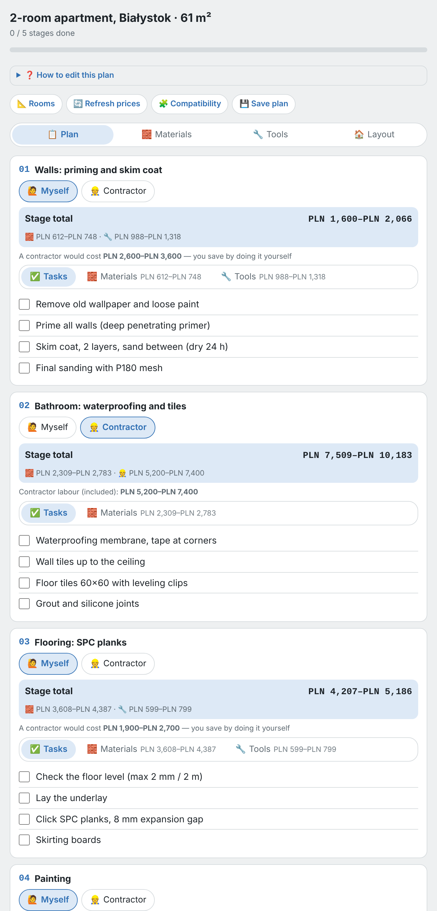
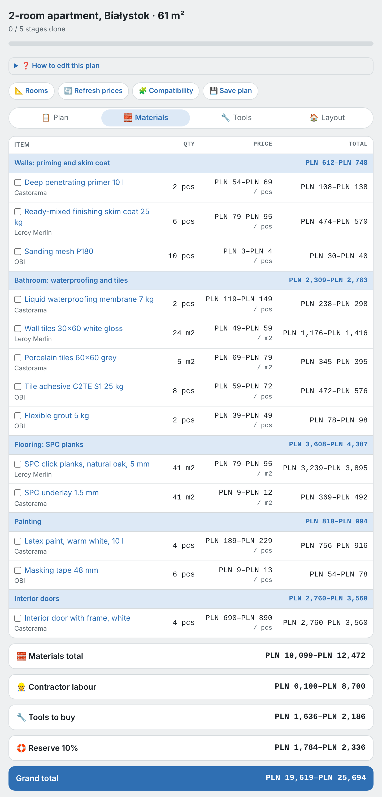
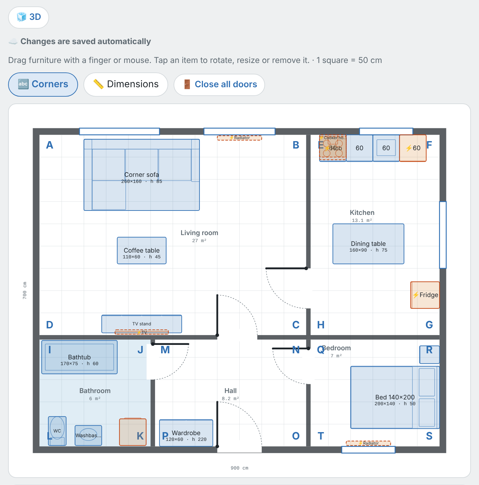
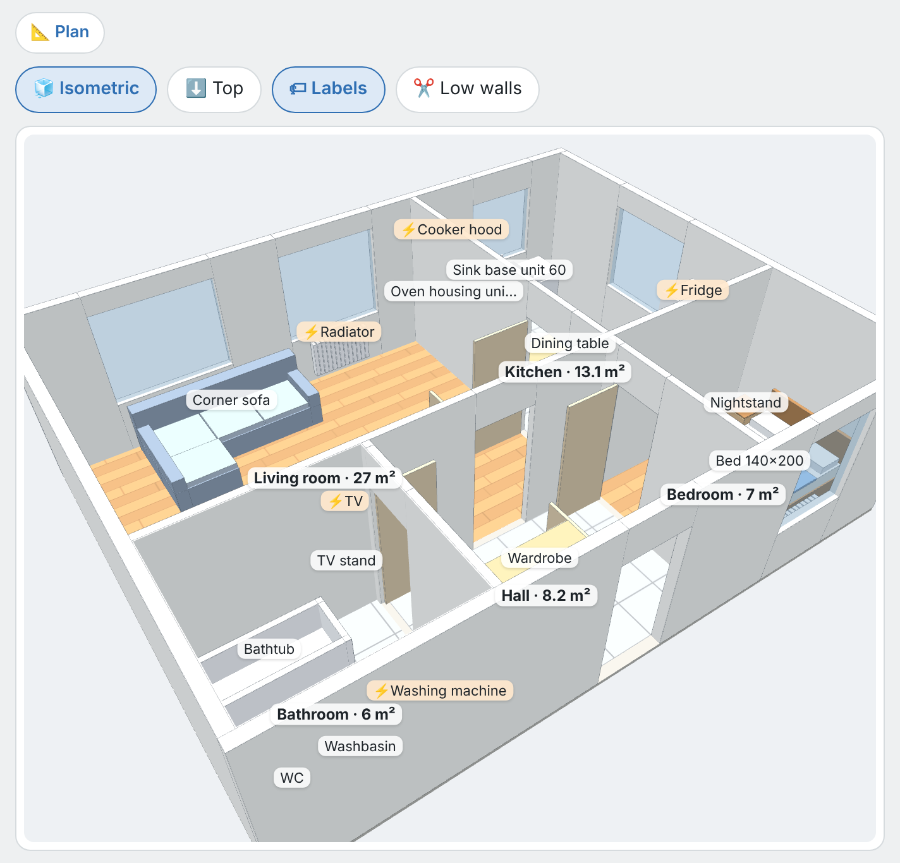

# Remont — AI renovation planner (MCP server)

Plan an apartment or house renovation with Claude (or any MCP client): a step-by-step plan, material
quantities calculated from your room sizes, prices from local DIY stores with links, contractor rates,
an interactive checklist, a floor layout with furniture and a 3D view.

[](https://glama.ai/mcp/connectors/io.github.Vutik/remont)

**Server URL:** `https://remont-mcp.wrpzdm9jmt.workers.dev/mcp` (Streamable HTTP, no sign-in)

[Website](https://vutik.github.io/remont-mcp/) ([RU](https://vutik.github.io/remont-mcp/ru/) · [PL](https://vutik.github.io/remont-mcp/pl/) · [UK](https://vutik.github.io/remont-mcp/uk/) · [DE](https://vutik.github.io/remont-mcp/de/)) · [Privacy policy](https://remont-mcp.wrpzdm9jmt.workers.dev/privacy) · [Support](https://remont-mcp.wrpzdm9jmt.workers.dev/support)

| Plan | Materials | Floor layout | 3D |
| --- | --- | --- | --- |
|  |  |  |  |

## What it does

- **Questionnaire**: apartment or house, rooms and areas, which works — or send a floor plan photo and Claude reads the rooms from it.
- **Materials from room sizes**: paint, putty, primer, tiles, adhesive, grout, flooring, underlay, drywall and more, with packs and waste.
- **Work order**: stages in the right sequence with drying times; tasks as a checklist.
- **Local prices**: DIY stores of your country with product links; standard / premium / luxury options per finish.
- **DIY or contractor** per stage, with labour rates; tools to buy or rent; total with a 10% reserve.
- **Floor layout**: rooms with corner letters and side lengths, doors you can flip and open/close, draggable furniture and appliances, ready arrangements, and a 3D view.
- **Saved plans**: a personal code opens your plans in any chat or by a link; purchases and ticks are kept.
- **22 countries built in** (EU, UK, US, Canada, Ukraine and more); for other countries Claude adds the currency and stores.
- **Languages**: English, Polish, German, Ukrainian, Russian built in; other languages translated by Claude.

## Connect

**Claude:** on claude.ai open Settings → Connectors → Add custom connector and paste the server URL. It then works in the desktop and mobile apps too.

**ChatGPT:** with developer mode on, add a custom connector (app) with the server URL and no authentication.

**Claude Code:**

```sh
claude mcp add --transport http remont https://remont-mcp.wrpzdm9jmt.workers.dev/mcp
```

**Cursor / VS Code / other clients** (`mcp.json`):

```json
{
  "mcpServers": {
    "remont": { "url": "https://remont-mcp.wrpzdm9jmt.workers.dev/mcp" }
  }
}
```

The interactive plan, questionnaire and layout are MCP Apps widgets; clients without MCP Apps support get the same plan as text.

## Try it

- "I want to renovate my 2-room apartment in Warsaw: living room 20 m², bedroom 14 m², bathroom 4 m². Make a plan."
- "Plan a bathroom remodel in Austin, TX — 5×8 ft, new tiles, vanity and toilet, I'll hire a contractor."
- "Here is my floor plan (image). Paint all rooms and lay vinyl flooring — how much material and money do I need?"
- "Draw the layout of my flat and let me arrange the furniture."

## Privacy

No account and no personal data. Saved plans are stored under a random code; plan links are unguessable and not indexed.
Details: [privacy policy](https://remont-mcp.wrpzdm9jmt.workers.dev/privacy).

## Support

Questions and bug reports: [support form](https://remont-mcp.wrpzdm9jmt.workers.dev/support) or GitHub issues in this repository.
